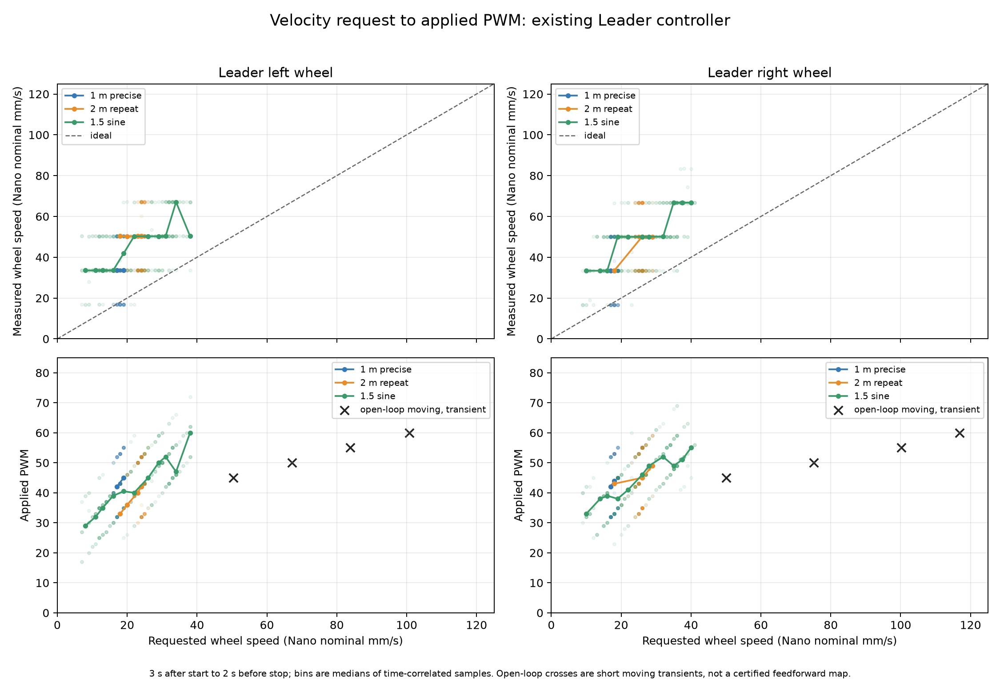

# Leader：以目標輪速為輸入檢查目前的 PWM 映射（2026-11-17）

使用者指出，直線／路徑控制應先指定左右輪速度，再由每輪控制器求 PWM；不能把相同 PWM 當作等輪速或拿開環 PWM 試跑當成直線控制驗證。原定 `45/45` 開環測點只做完接地預檢（左／右 count 約 728／815、航向 +7.3°、旗標正常），在正式測點的最終擺位確認前取消。Pi 收到 Ctrl-C，Nano 連續兩次 `STOP` ACK，後續唯讀 `STATUS` 為 idle、PWM 0、fault 0；**沒有執行 PWM 45/45 的正式測點，也沒有新增此點的曲線 CSV**。

以 [1 m 尺讀直線](../2026-11-16-straight-1m-precise/leader.csv)、[2 m 重測](../2026-11-16-straight-2m-repeat/leader.csv)與[右起始 1.5 波](../2026-11-17-sine-right-run/leader.csv)為資料。只取 `control`、`velocity`、fault=0、啟動後 3 s 至停止前 2 s、目標 TPS ≥20、PWM>0；繪出左右輪的「目標輪速→實測輪速」及「目標輪速→控制器實際輸出的 PWM」。mm/s 全按 Nano 現行 65 mm 輪徑和每圈 count 換算，**不是地面實速**。線是每 3 mm/s 分箱、至少 5 個時間相鄰樣本的中位數；這些樣本不是獨立重複試次。

| 有效舊試次 | 左輪目標／實測、PWM 中位 | 右輪目標／實測、PWM 中位 |
| --- | --- | --- |
| 1 m 尺讀直線 | 18.00 → 33.56 mm/s；PWM 43 | 18.01 → 33.38 mm/s；PWM 43 |
| 2 m 重測 | 24.01 → 50.33 mm/s；PWM 42 | 25.99 → 50.08 mm/s；PWM 45 |
| 1.5 波 | 24.01 → 50.30 mm/s；PWM 43 | 25.99 → 50.08 mm/s；PWM 45 |

圖下方叉號來自[已起轉逐級降 PWM](../2026-11-16-leader-pwm-sweep/running.csv)的短暫態：先觀察 `PWM→實測 TPS`，再把兩軸交換成「量到的速度→PWM」候選點。它們的速度約落在 Nano 名義 50–117 mm/s，**沒有涵蓋前述目標約 18–26 mm/s 的低速區，也沒有 1–2 s 穩態重複**。不能由叉號直接指定 18–26 mm/s 要用多少 PWM，更不能把閉環樣本的 PWM 對目標速度直接回歸成馬達特性：當輪速過高，回授會把 PWM 往下拉，造成反向因果。

目前 Nano 韌體的前饋公式為 `55 + 0.14×目標 TPS`，加上比例與積分修正；上述直線資料反推負積分接近 `−220` 限幅。這個既有「速度→PWM」映射在低速區給太高的起始 PWM，回授又缺少足夠、可穩定的降速空間。實際應採逐輪的 `PWM_ff,L(v*)`、`PWM_ff,R(v*)`，再用 encoder 誤差修正；起轉與已轉動的前饋要分開，並做抗積分飽和。每輪的可用低速節點、起轉時長與 PI 參數仍待重複量測，**沒有修改或重燒 Nano**。

下一個有效試驗應先在地面短距離、可隨時 STOP 的條件下，用「目標左右輪速度相等」為主要命令，記錄每輪同窗 count 斜率、實測 TPS、PWM、地面 MPU 位置與航向。當前未修正韌體在 `18/18 mm/s` 的相同測法已因 −20.3° 護欄中止；再次跑同一設定不會提供新的前饋曲線。先完成低速前饋候選及離線檢查，再以短距離驗證速度跟隨與直線性。

重畫：`MPLCONFIGDIR=/private/tmp/mpl_velocity_pwm ./.venv/bin/python analysis/2026-11-17-velocity-pwm/plot_velocity_pwm.py`。機讀摘要在 [summary.json](summary.json)。
